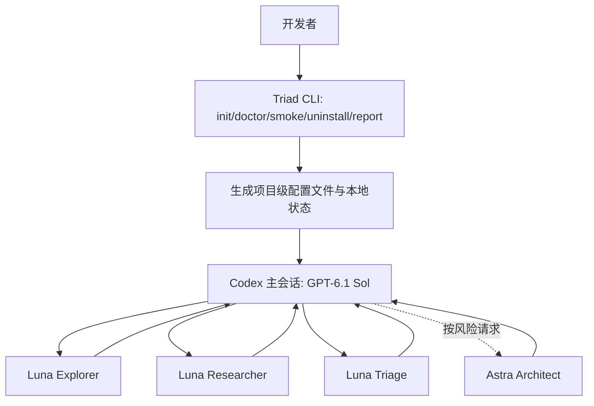

# 产品需求与技术设计草案（PRD + Architecture）

## 产品愿景与范围

- 面向 Codex 桌面/CLI 的三级分工、跨平台、原生 custom subagent 安装与诊断工具。
- 首期不引入额外 API 服务、浏览器控制中心、模型路由网关；尽量不依赖外部 Python 包。
- 通过项目级 `.codex/` + `AGENTS.md` 达到用户可见、可逆、可审计的配置。

## 必须实现的用户故事

| ID | 用户故事 | 可验收条件 |
|---|---|---|
| US-01 | 我可以不覆盖现有配置就启用 Triad | `init --dry-run` 展示影响，`init` 不改其他用户字段 |
| US-02 | 我可以知道我的 Codex 是否准备就绪 | `doctor` 输出结构化结果并区分 PASS/WARN/FAIL/UNKNOWN |
| US-03 | 我可以确认子 Agent 是否真的运行 | smoke instructions + 证据采集，不能自述代替 UI/运行时证据 |
| US-04 | 我可以安全退出 Triad | `uninstall --dry-run`，移除仅本工具拥有的内容 |
| US-05 | 我可以把三层方案与单模型做对照实验 | 数据模板、明确指标、可重现汇总 |
| US-06 | 我可以替换模型 ID 与推理强度 | 参数化生成，验证模型配置组合/错误提示 |
| US-07 | 我能判断问题是模型不可用还是配置没加载 | FAQ + 版本/权限/提供方诊断，不读取密钥 |

## 架构边界

### 主线程与子线程责任

- Sol：确定验收标准、实施源码变更、最小充分测试、协调子任务、整合结果、向用户汇报。
- Luna workers：只负责有限范围调查，报告包含文件路径/关键符号/证据/未解事项；默认不修改代码，防止并发写冲突。
- Astra：在关键风险节点进行高质量审查，返回 APPROVE / APPROVE_WITH_CONDITIONS / BLOCK / INSUFFICIENT_EVIDENCE；不替代主 Agent 的最终执行决策。

### 主要安全不变量

- 子 Agent 继承父会话的沙箱、权限、MCP、提供方；自定义 Agent 里的“只读”描述不等于沙箱隔离。
- 未经批准禁止静默 push、部署、泄露 `.env`、密钥或用户数据。
- 文件所有权：Triad 只负责由状态文件确认为自己管理的范围；冲突时失败而非覆盖。
- 无隐式模型调用、无遥测上传、无硬编码个人数据。
- 配置文件无法赋予用户未拥有的模型访问权限；代理/中转站不可通过 Agent TOML 直接更换提供方。

## 质量属性

- **安全**：幂等、原子写入、回滚、不跨越项目路径；慎用符号链接、Windows junction。
- **正确性**：不编造 Codex 支持的字段与有效模型调用；未知信息用 UNKNOWN。
- **可维护**：小模块、稳定 CLI、测试覆盖、CI 跨平台。
- **可观察**：调试步骤可重复、日志可脱敏、失败原因可分类。
- **易用性**：初次安装最多几个命令；中文与英文说明同步。

## 兼容与约束

- 最低 Python 3.11；优先 Windows 11 PowerShell，覆盖 Linux/macOS。
- 优先现成原生 Codex agent TOML：`name`、`description`、`developer_instructions` 必须存在。
- 可选 `model`、`model_reasoning_effort`；全局 `[agents]` 包含 `enabled`、`max_concurrent_threads_per_session`、`default_subagent_model`、`default_subagent_reasoning_effort`（以实施时最新官方文档为准）。
- 项目级配置可能因目录信任、显式启动参数、用户全局配置和版本不同而产生覆盖/忽略；需实测。

## 建议迭代指标（目标，不代表已有实测）

- 所有已有离线回归测试通过；对新行为补测试。
- 在干净测试仓库与带已有配置的仓库中，安装/卸载均不损坏非 Triad 内容。
- 至少一台 Windows Codex 客户端能完成真实 Luna worker + Astra advisor 的手动烟测并可核实成功/失败。
- A/B 评测有可下载原始记录和实验方法；不预设成本降低百分比。

## 0.2 实施决策

实际落地见 [ADR-001](../ADR-001-SAFE-INSTALL.md)；配置字段与优先级核对见 [官方兼容性](../OFFICIAL_COMPATIBILITY.md)。运行验收和本地测试分别记录，不能互相代替。恢复记录为短期本地备份，可能含目标配置敏感内容，不上传、不提交。
